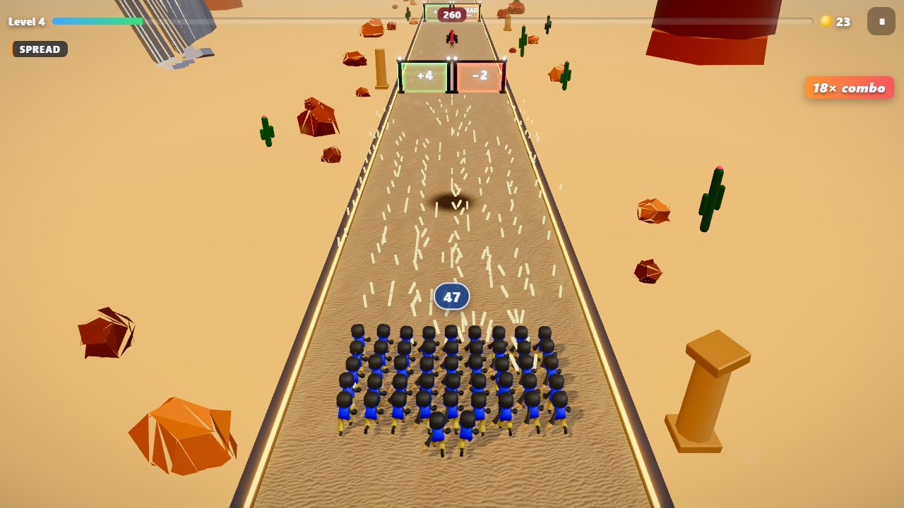
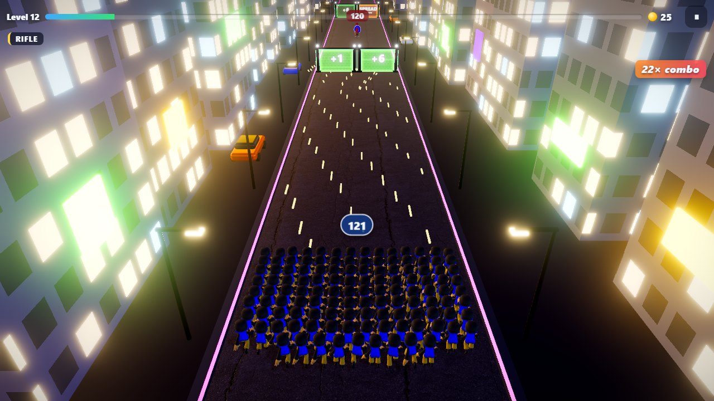
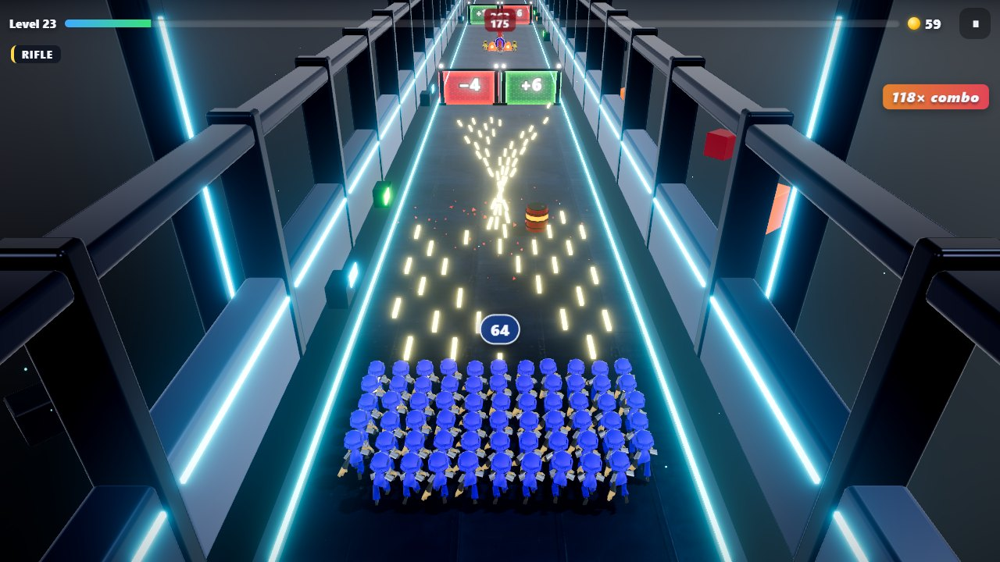
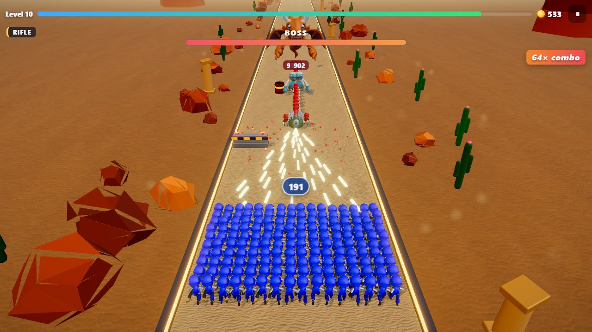
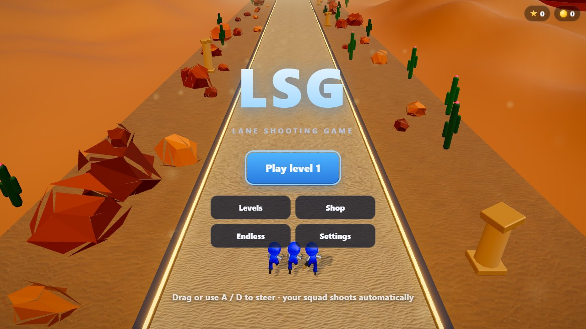
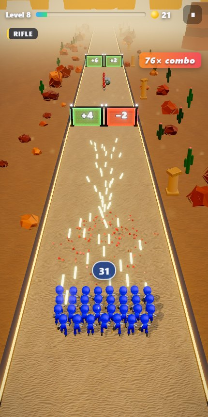
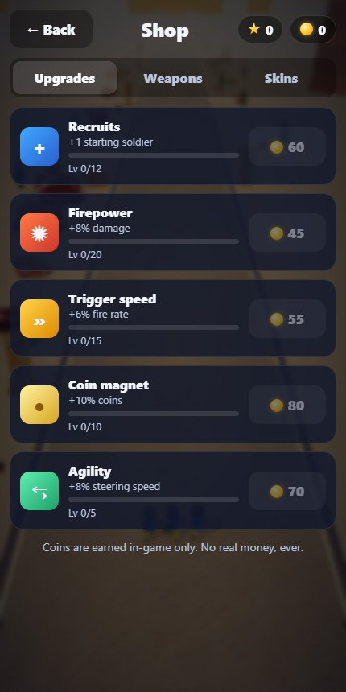

<div align="center">

# LSG – Lane Shooting Game

**A 3D lane shooter that runs in your browser. No ads, no tracking, no real-money purchases.**

Steer your squad, shoot the gates, multiply your army and crush the horde.

### [▶ Play now at lsg.gleesh.net](https://lsg.gleesh.net)

[](https://github.com/cpfaffinger/lsg/releases)




</div>

## The game

You have probably seen this game in an ad. Here it is as the real thing: free, instant, and with nothing between you and the next level.

Your squad runs forward on its own and fires automatically. You only steer left and right. Every gate on the lane changes the soldiers who walk through it: `+9` adds soldiers, `×3` multiplies them, `-2` costs you some. Shoot a gate on the way in and its value climbs. A wide squad can split across both gates, so where you stand matters.

<table>
  <tr>
    <td></td>
    <td></td>
  </tr>
  <tr>
    <td></td>
    <td></td>
  </tr>
</table>

<table>
  <tr>
    <td width="50%"></td>
    <td width="50%"></td>
  </tr>
</table>

## Features

- **30-level campaign** through three worlds, Dust Valley, Neon City and Orbit Station, with mini-bosses and bosses, plus an **endless mode**.
- **Gates that count**: each gate changes exactly the soldiers who pass through it.
- **Four weapons**: rifle, spread gun, piercing laser and rockets, from gates or as a start weapon from the shop.
- **Real hordes** from the first level: waves grow with your squad, alongside tanks, shooters, splitters, shield bearers and walking bombs.
- **A late game with teeth:** shield walls, pincer attacks, ambushes, trap gates and dragons that breathe walls of fire.
- **Fair progression**: upgrades, weapons and skins cost in-game coins only. There is nothing to buy with real money.
- **Built for phones, equally good on desktop**: one-finger steering or keyboard, automatic quality adjustment, portrait and landscape.
- **Installable and offline-capable** as a Progressive Web App, playable as a guest without any account.
- **Optional Google sign-in** to carry your progress across devices.
- **Four music styles** to switch between: standard, synthwave, 90s disco and EDM.
- **English and German**, with reduced-motion, colorblind and haptics settings.
- **Debug replays**: download any run as a small JSON file and rerun it step by step.

## How it is built

| Part       | Technology                                                                                                         |
| ---------- | ------------------------------------------------------------------------------------------------------------------ |
| Game       | TypeScript, Three.js, Vite, deterministic simulation, GPU-instanced skeletal animation, particles, post-processing |
| Admin area | Preact single-page app under `/admin`                                                                              |
| Backend    | Fastify on Node 24, SQLite via `node:sqlite`                                                                       |
| Sign-in    | Google OpenID Connect with PKCE; the admin area uses local accounts with optional TOTP                             |
| Delivery   | Docker Compose with nginx, one plain HTTP port, content-hashed assets, service worker                              |
| Balancing  | Bots that play every level, an automatic tuner and a full-campaign economy simulation                              |

```
apps/game        Three.js game client
apps/admin       Admin SPA
apps/api         Fastify API and SQLite database
packages/shared  Types and schemas shared by all apps
tools/           Balancing bots, replay analysis, screenshots, asset download, deployment
docker/          Dockerfiles, nginx config, entrypoint
docs/            Concept, roadmap and asset credits
```

## Run it yourself

Requirements: Docker Engine with Compose v2.24 or newer.

```bash
git clone https://github.com/cpfaffinger/lsg.git
cd lsg
cp .env.example .env        # optional, all values have defaults
docker compose up -d --build
```

Open `http://localhost:8080` for the game and `http://localhost:8080/admin/` for the admin area.

The stack exposes exactly **one plain HTTP port** (`LSG_HTTP_PORT`, default `8080`). TLS, certificates and the public reverse proxy are intentionally not part of this project: point your proxy at this port. When the proxy runs on the same host, set `LSG_HTTP_BIND=127.0.0.1`.

### Services

| Service | Purpose                                                                       | Exposed              |
| ------- | ----------------------------------------------------------------------------- | -------------------- |
| `web`   | nginx: serves the game and the admin SPA, forwards `/api` to `api` internally | `LSG_HTTP_PORT` → 80 |
| `api`   | Fastify backend: accounts, progress sync, admin API, SQLite database          | internal only        |

### Data and backups

All persistent data lives in `./data` next to `docker-compose.yml` (bind mount, no Docker volumes):

| Path                 | Content                                                        |
| -------------------- | -------------------------------------------------------------- |
| `data/db/lsg.sqlite` | SQLite database (WAL mode)                                     |
| `data/secret.key`    | Auto-generated encryption key (if `LSG_SECRET_KEY` is not set) |
| `data/backups/`      | Daily database snapshots, 14 are kept                          |
| `data/logs/`         | Daily server logs, kept for 30 days                            |

Back up by copying the whole `data` folder. For a guaranteed-consistent database file while the server runs, use the snapshots in `data/backups/`. **Keep `secret.key` together with the database**: without it, stored secrets such as the Google client secret cannot be decrypted.

### First start: admin account

On the first start the API creates an admin account:

- With `LSG_ADMIN_USER` / `LSG_ADMIN_PASSWORD` (12+ characters) in `.env`, those credentials are used.
- Otherwise a random password is generated and written to `data/initial-admin-password.txt`. You must change it on first login; the file is then deleted.

The admin area uses local accounts only, never Google, and supports an authenticator app as second factor.

### Google sign-in for players (optional)

Players can always play as guests. To let them keep progress across devices:

1. Admin → **Settings** → set the **Public URL** (e.g. `https://lsg.example.com`).
2. Admin → **Google sign-in** shows a step-by-step guide with the exact values to enter in the Google Cloud Console, with copy buttons.
3. Paste the client ID and secret (stored encrypted), run **Test sign-in with Google**, then enable it.

### Running behind Cloudflare

- Set the public URL in the admin area. Google redirect URLs and secure cookies are derived from it.
- The real client IP is read from `CF-Connecting-IP` (`LSG_CLIENT_IP_HEADER`). Only expose the HTTP port to Cloudflare or your proxy, otherwise this header can be spoofed.

## Development

```bash
docker compose -f docker-compose.yml -f docker-compose.dev.yml up --build
```

The game runs at `http://localhost:5173` and the admin area at `http://localhost:5174/admin/`, both with hot reload. Without Docker, Node 24 or newer is enough:

```bash
npm install
npm run dev:api     # http://localhost:3000
npm run dev:game    # http://localhost:5173
npm run dev:admin   # http://localhost:5174/admin/
```

| Command               | Purpose                                                      |
| --------------------- | ------------------------------------------------------------ |
| `npm run check`       | Lint, typecheck, tests and production build                  |
| `npm run probe`       | Bots of three skill levels play every campaign level         |
| `npm run replay -- f` | Reruns and summarises a debug file downloaded from the game  |
| `npm run screenshots` | Regenerates the README screenshots from a running dev server |

`tools/balance/tune.ts` searches each level's difficulty and boss strength, and `tools/balance/economy.ts` plays the whole campaign with upgrades and retries. Rerun the tuner after changing the level generator or `apps/game/src/sim/balance.ts`.

In the dev build, `http://localhost:5173/?viewer` opens a model viewer and the running game is available as `window.lsg`.

## Credits

Characters and weapons come from [Quaternius](https://quaternius.com), sound effects from [Kenney](https://kenney.nl), music from artists on [OpenGameArt](https://opengameart.org), and textures and lighting from [Poly Haven](https://polyhaven.com), all under CC0. Every third-party asset is listed with its source and license in [docs/ASSETS.md](docs/ASSETS.md) and in the game's credits. Concept and roadmap live in [docs/](docs/) (German).
